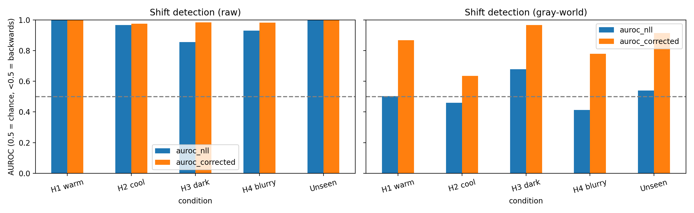
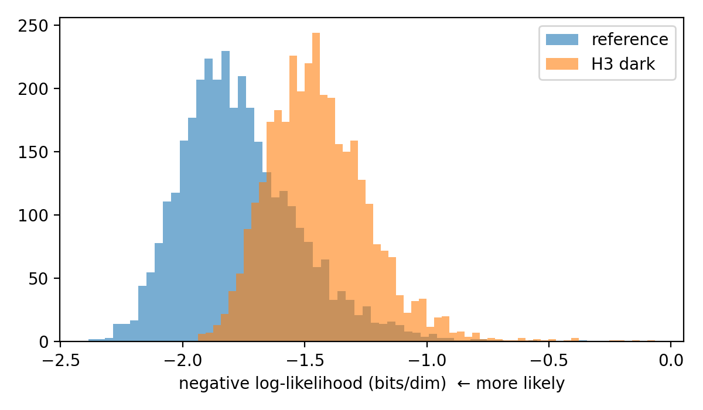
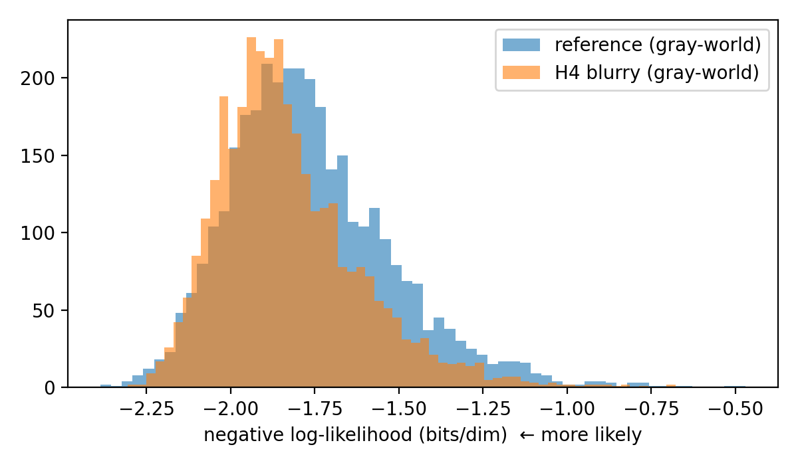

# Can a VAE Detect When a Hospital's Images Are Different?

**Question:** In my [federated learning project](https://github.com/Bhuvan152/fl-blood-cell-heterogeneity), hospital-specific stain, brightness, and blur shifts silently broke a classifier. Can a deep generative model trained on reference images flag shifted images by their likelihood, and when does likelihood mislead?

## Setup
- **Data:** BloodMNIST (28×28 RGB). The VAE is trained on the 11,959 original training images.
- **Shifts:** the 5 hospital conditions from my federated learning project (warm, cool, dark, blurry, unseen), applied to the **same 3,421 test images**, so only appearance differs from the reference.
- **Model:** convolutional VAE (32-dim latent) with a Gaussian likelihood and learned per-channel noise, trained for 20 epochs with Adam.
- **Likelihood:** importance-weighted estimate of log p(x) with 16 samples (a tighter bound than the ELBO).
- **Complexity correction:** score = −log₂ p(x) − PNG-compressed size in bits, following the input-complexity idea for likelihood-based out-of-distribution detection.
- **Gray-world:** a second VAE trained and evaluated on gray-world color-normalized images.
- **Metrics:** AUROC for separating shifted from reference images; the fraction of images whose negative log-likelihood (NLL) increases after shifting (a paired, image-by-image comparison); and the average change in NLL and compressed size, in bits per dimension.

## Results

| Setting | Condition | AUROC (NLL) | AUROC (corrected) | Frac. NLL up | ΔNLL (bits/dim) | ΔPNG (bits/dim) |
|---|---|---|---|---|---|---|
| Raw | H1 warm | 0.998 | 1.000 | 0.998 | 1.772 | −0.474 |
| Raw | H2 cool | 0.966 | 0.974 | 0.999 | 0.617 | −0.143 |
| Raw | H3 dark | 0.855 | 0.984 | 0.958 | 0.325 | −0.487 |
| Raw | H4 blurry | 0.930 | 0.983 | 1.000 | 0.510 | −0.343 |
| Raw | Unseen | 1.000 | 1.000 | 1.000 | 3.732 | −0.486 |
| Gray-world | H1 warm | 0.503 | 0.868 | 0.469 | −0.007 | −0.426 |
| Gray-world | H2 cool | 0.459 | 0.635 | 0.307 | −0.038 | −0.150 |
| Gray-world | H3 dark | 0.678 | 0.967 | 0.795 | 0.152 | −0.469 |
| Gray-world | H4 blurry | 0.413 | 0.779 | 0.100 | −0.067 | −0.350 |
| Gray-world | Unseen | 0.540 | 0.914 | 0.591 | 0.021 | −0.438 |

AUROC of 0.5 is chance; below 0.5 means likelihood ranks shifted images as *more* typical than reference images.

**Raw setting, dark hospital:** shifted images are less likely than reference images, so likelihood detects them.

**Gray-world setting, blurry hospital:** blurred images are slightly *more* likely than reference images. The distributions overlap, but the effect is consistent: comparing each image before and after blurring, 90% became more likely.

## Findings
1. **Raw likelihood detects stain and color shifts reliably** (AUROC 0.86–1.00).
2. **Detection is weakest where shifts make images simpler.** The dark hospital (AUROC 0.855) had the largest drop in compressed size (−0.487 bits/dim). Correcting for input complexity raised detection to 0.984.
3. **After gray-world normalization, likelihood rates blurred images as *more* likely than in-distribution images** (AUROC 0.413; 90% of images gained likelihood after blurring). This reproduces the known failure of deep generative models on simpler inputs, and it appears only once the obvious color cue is removed.
4. **"Invisible to the likelihood" is not "the same."** Gray-world makes color-shifted hospitals look in-distribution to raw likelihood (AUROC ≈ 0.5), but the complexity-corrected score still detects them (0.64–0.97). That reveals residual information loss from clipping and blur, consistent with gray-world not fully fixing the dark and blurry hospitals in my federated learning project.

## Limitations
- One dataset, 28×28 images, simulated shifts, and one VAE seed
- PNG size is a rough proxy for image complexity, and it mixes a discrete code length with a continuous density. This adds a constant offset that does not affect AUROC.
- A small VAE; stronger likelihood models (normalizing flows, diffusion models) may behave differently

## Related projects
- [Federated learning under imaging shift](https://github.com/Bhuvan152/fl-blood-cell-heterogeneity): batch-norm statistics explain federated learning failure across hospitals
- [Fairness and normalization on HAM10000](https://github.com/Bhuvan152/fair-skin-lesion-bn): per-group normalization backfires when group differences are tied to disease prevalence

## How to run
Open `vae_hospital_shift_detection.ipynb` in Google Colab and run all cells (CPU, about 15 minutes).
